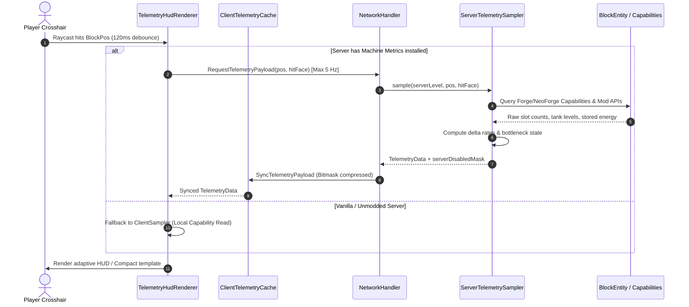
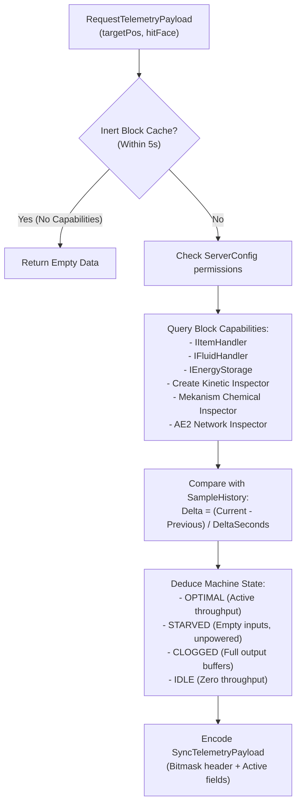
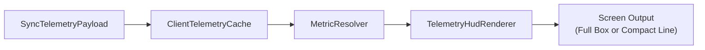

# Telemetry Data Flow

Machine Metrics uses an on-demand polling model. The server does not scan chunks, track active block entities in the background, or push unsolicited metrics. Telemetry calculations execute only when a player looks at a machine with the HUD enabled.

---

## Architecture Overview

---

## 1. Client Raycast & Debounce

When the player points their crosshair at a block:

1. **Raycast Verification**: `TelemetryHudRenderer` checks `Minecraft.getInstance().hitResult`. Non-block hits immediately invalidate active targets.
2. **Debounce (120 ms)**: Prevents sending packets when rapidly sweeping the crosshair across multiple blocks. The player must rest their crosshair on a block entity for at least `120ms`.
3. **Throttling (200 ms / 5 Hz)**: Once locked on a target, requests are sent at most once every `200ms` to keep network overhead low.
4. **Packet Dispatch**: The client sends a `RequestTelemetryPayload` containing:
   - `BlockPos targetPos` (8 bytes)
   - `Direction hitFace` (1 byte, nullable)

---

## 2. Server Sampling & State Deduction

The server handles `RequestTelemetryPayload` on the main server thread via `NetworkHandler`:

### Capability Sampling

The sampler queries supported capabilities on all 6 faces plus the center block:
- **NeoForge/Forge Capabilities**:
  - `Capabilities.ItemHandler.BLOCK`: Item inventory and slot counts.
  - `Capabilities.FluidHandler.BLOCK`: Tank capacities and fluid amounts.
  - `Capabilities.EnergyStorage.BLOCK`: Stored FE amounts.
- **Mod Integrations**:
  - **Create**: Reads rotational speed, network stress draw, capacity (SU), and overstress flags directly from `KineticBlockEntity`.
  - **Mekanism**: Inspects chemical tanks (Gas, Infuse, Pigment, Slurry) via Mekanism API.
  - **Applied Energistics 2**: Traverses the grid via `IGridNodeHost` to calculate net power rate, active drain, buffer percentage, stability states (`STABLE`, `BROWNOUT`, `BOOTING`, `DISCHARGING`, `CREATIVE`), and connected quartz fiber subnet drain.

### Rate Calculation

Rates use differential time sampling against `SampleHistory`:
- The server stores the previous sample timestamp and contents for active targets.
- Throughput is calculated as:
  $$\text{Rate} = \frac{\Delta \text{Transferred}}{\Delta t}$$
- If no throughput occurs for 3 consecutive samples while inventories remain constant, the machine transitions to `IDLE`.

---

## 3. Network Payload Compression

`SyncTelemetryPayload` uses bitmask serialization. Instead of writing every metric field over the network, a 1-byte presence mask indicates which data fields follow in the packet:

| Bit Flag | Mask Name | Payload Written if Bit Set |
| :--- | :--- | :--- |
| `0x01` | Items | `float itemThroughput`, `boolean hasItems` |
| `0x02` | Fluids | `float fluidThroughput`, `boolean hasFluids` |
| `0x04` | Energy | `float energyDelta`, `boolean hasEnergy` |
| `0x08` | Kinetic | `float speed`, `stress`, `capacity`, `byte direction` |
| `0x10` | Chemicals | `float chemicalThroughput`, `boolean hasChemicals` |
| `0x20` | AE2 | `float powerRate`, `powerDrain`, `subnetDrain`, `short subnets`, `double stored`, `double max`, `byte stability`, `int usedChannels`, `int maxChannels` |
| `0x40` | Directional Sides | Variable length array of per-face active rates |
| `0x80` | Server Disabled Mask | `short serverDisabledMask` (Flags restricted features) |

In typical operation on inactive or simple blocks, packets require under 16 bytes of network payload. Full multi-mod machines require approximately 28 to 44 bytes per sync packet.

---

## 4. Client Caching & HUD Presentation

1. **Cache Update**: `handleSyncPayload` updates `ClientTelemetryCache` under `targetPos`.
2. **Formatting**: `MetricResolver` converts numerical values to compact units (`k`, `M`, `RPM`, `mB/s`, `FE/t`, `AE/t`) and applies configured color codes.
3. **Rendering**:
   - **Full Box**: Calculates dynamic width and height based on visible element count, draws background box, borders, and text lines.
   - **Compact Mode**: Evaluates `compact_template` placeholders and renders a single-line string.

---

## 5. Lifecycle and Cache Eviction

- **Target Switching**: When the player's crosshair leaves a block, `ClientTelemetryCache.remove(targetPos)` immediately clears the client cache to prevent stale data when returning to that position.
- **Server Cache Expiration**: Inactive targets in `ServerTelemetrySampler.CACHE` expire after 10 seconds without requests.
- **Inert Blocks**: Blocks lacking compatible capability providers are stored in `INERT_BLOCK_CACHE` for 5 seconds to bypass redundant capability checks on ordinary building blocks.
