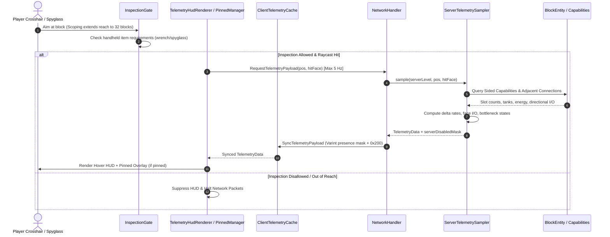
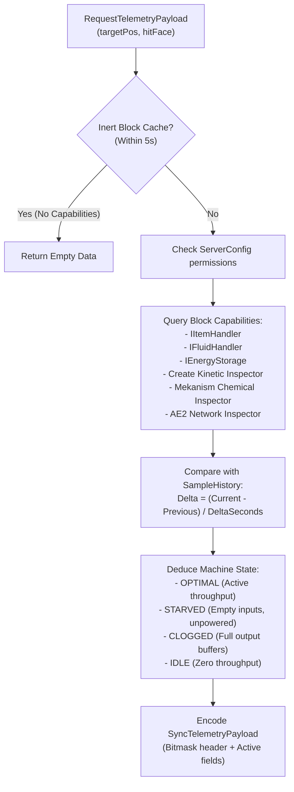
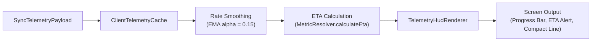

# Telemetry Data Flow

Machine Metrics uses an on-demand polling model. The server does not scan chunks, track active block entities in the background, or push unsolicited metrics. Telemetry calculations execute only when a player looks at a machine with the HUD enabled.

---

## Architecture Overview

---

## 1. Client Raycast, Inspection Gate & Debounce

When the player points their crosshair at a block:

1. **Inspection Gate Verification**: `InspectionGate.canInspect(player)` checks if `requireInspectionItem` is active. If enabled, the player must hold an item matching `inspectionItemTags` (`#c:tools/wrench`, `minecraft:spyglass`) in either their main hand or offhand. If unmet, HUD rendering is suspended and outbound packet dispatch is aborted (0% network overhead).
2. **Raycast & Zoom Mode**: 
   - Under standard view, `InspectionGate.performRaycast(mc)` uses vanilla block reach (~4.5 blocks).
   - When the player is scoping with a Spyglass (`player.isScoping()`), reach extends up to `spyglassRaycastDistance` (default 32.0 blocks) through `mc.level.clip(...)`.
   - `hitFace` is extracted from `BlockHitResult.getDirection()`. Non-block hits immediately invalidate active hover targets.
3. **Debounce (120 ms)**: Prevents sending packets when rapidly sweeping the crosshair across multiple blocks. The player must rest their crosshair on a block entity for at least `120ms`.
4. **Throttling (200 ms / 5 Hz)**: Once locked on a target, requests are sent at most once every `200ms` to keep network overhead low.
5. **Packet Dispatch**: The client sends a `RequestTelemetryPayload` containing:
   - `BlockPos targetPos` (8 bytes)
   - `Direction hitFace` (1 byte, nullable: ordinal 0–5 or -1)

---

## 2. Server Sampling & State Deduction

The server handles `RequestTelemetryPayload` on the main server thread via `NetworkHandler`:

### Capability Sampling

The sampler queries supported capabilities on all 6 faces plus the center block:
- **NeoForge/Forge Capabilities**:
  - `Capabilities.ItemHandler.BLOCK`: Item inventory and slot counts.
  - `Capabilities.FluidHandler.BLOCK`: Tank capacities and fluid amounts.
  - `Capabilities.EnergyStorage.BLOCK`: Stored FE amounts.
- **Adjacent Connection Filtering**:
  - Sided queries verify that the adjacent neighboring block at `pos.relative(face)` can connect to or host matching capabilities via `StorageAccess.hasStorageCapability`.
  - Unconnected faces touching open air or inert blocks are ignored, preventing machine internal slot deltas from leaking onto unconfigured faces or triggering phantom throughput.
- **Directional I/O Classification**:
  - The targeted face specified by `hitFace` is evaluated for flow direction: `[INPUT]` (can insert / incoming delta), `[OUTPUT]` (can extract / outgoing delta), or `[BIDIRECTIONAL]` (both or shared bus).
  - Face-specific instantaneous throughput is calculated and packed into `SyncTelemetryPayload`.
- **Targeted Face Bottleneck State**:
  - Sided states (`CLOGGED`, `STARVED`, `OVERLOADED`) are deduced for the targeted face. Redundant `[OPTIMAL]` states are suppressed on the face line when active throughput is already displayed.
- **All-Sides Grouping**:
  - Side rates only collapse into a single `[ALL SIDES]` summary when all 6 cardinal directions are actively transferring at identical rates.
  - The targeted face is excluded from the secondary per-side breakdown to eliminate duplicate lines on the HUD.
- **Mod Integrations**:
  - **Create**: Reads rotational speed, network stress draw, capacity (SU), and overstress flags directly from `KineticBlockEntity`.
  - **Mekanism**: Reads chemical tanks (Gas, Infuse, Pigment, Slurry). For logistical transporters, inspects active in-flight transit stacks directly to measure item rate and stack capacity, bypassing dummy item handlers.
  - **Storage Drawers & Functional Storage**: Queries drawer controllers and slave blocks directly to sum items and maximum capacity without slot iteration overhead.
  - **Applied Energistics 2**: Traverses the grid via `IGridNodeHost` to calculate net power rate, active drain, buffer percentage, stability states (`STABLE`, `BROWNOUT`, `BOOTING`, `DISCHARGING`, `CREATIVE`), and connected quartz fiber subnet drain.

### Rate Calculation & Storage Tracking

Rates use differential time sampling against `SampleHistory`:
- The server stores the previous sample timestamp and contents for active targets.
- Throughput is calculated as:
  $$\text{Rate} = \frac{\Delta \text{Transferred}}{\Delta t}$$
- Storage containers track total stored amount (`storageCurrent`) and maximum limit (`storageMax`).
- Net rate (`netRate`) tracks change per second across all slots or tanks, setting `IS_DRAINING` when negative. For transport cables, net rate stays at 0 to suppress draining alerts while items move through.
- If no throughput occurs for 3 consecutive samples while inventories remain constant, the machine transitions to `IDLE`.

---

## 3. Network Payload Compression

`SyncTelemetryPayload` uses bitmask serialization. A varint presence mask (`PRESENT_*`, distinct from `TelemetryData.MASK_*`) indicates which data fields follow in the packet:

| Bit Flag | Mask Name | Payload Written if Bit Set |
| :--- | :--- | :--- |
| `0x01` | Items | `float itemThroughput`, `boolean hasItems` |
| `0x02` | Fluids | `float fluidThroughput`, `boolean hasFluids`, `String fluidName`, `long fluidAmount`, `long fluidCapacity` |
| `0x04` | Energy | `float energyDelta`, `boolean hasEnergy` |
| `0x08` | Kinetic | `float speed`, `stress`, `capacity`, `byte direction` |
| `0x10` | Chemicals | `float chemicalThroughput`, `String chemicalName`, `long chemicalAmount`, `long chemicalCapacity` |
| `0x20` | AE2 | `float powerRate`, `powerDrain`, `subnetDrain`, `short subnets`, `double stored`, `double max`, `byte stability`, `int usedChannels`, `int maxChannels` |
| `0x40` | Directional Sides | Variable length array of per-face active rates |
| `0x80` | Server Disabled Mask | `short serverDisabledMask` (Flags restricted features) |
| `0x100` | Storage | `logisticsFlags`, `storageCurrent`, `storageMax`, `netRate` |
| `0x200` | Targeted Face | `byte targetedFace`, `byte targetedIoDirection`, `byte targetedState`, `float targetedThroughput` |

> The presence mask is a **varint**, not a single byte: the storage bit (`0x100`) and targeted face bit (`0x200`) exceed 8 bits, so packets carrying storage or targeted face data use a 2-byte varint header.

### Storage Sync Payload

When a block entity exposes inventory or fluid storage, the payload appends logistics data:
- `byte logisticsFlags`: Bitmask marking `HAS_STORAGE (0x01)`, `IS_INFINITE (0x02)`, and `IS_DRAINING (0x04)`.
- `long storageCurrent`: Current stored item or fluid amount.
- `long storageMax`: Maximum capacity across all slots or tanks.
- `float netRate`: Net throughput per second.

Inactive or simple blocks send under 16 bytes per packet. Full multi-mod machines send 28 to 44 bytes per sync packet.

---

## 4. Client Caching & HUD Presentation

1. **Cache Update & Smoothing**:
   - `ClientTelemetryCache` caches incoming data keyed by `BlockPos`.
   - Raw `netRate` undergoes exponential moving average smoothing ($\alpha = 0.15$) to filter hopper pulses and extraction spikes:
     $$R_{\text{smooth}} = \alpha \cdot R_{\text{instant}} + (1 - \alpha) \cdot R_{\text{prev}}$$
2. **ETA Derivation**:
   - `MetricResolver.calculateEta` divides remaining capacity (or current stored quantity when draining) by the smoothed rate:
     $$T_{\text{seconds}} = \frac{\text{Capacity} - \text{Current}}{R_{\text{smooth}}}$$
   - Returns `FULL_IN`, `EMPTY_IN`, `STATIONARY` (when $|R| \le 0.001$), or `INFINITE`.
3. **Formatting & Color Coding**:
   - `MetricResolver` formats numbers (`%,d` up to 10M, compact units above) and builds the 10-block progress bar (`[████░░░░░░]`, 1 block = 10%).
   - Evaluates fill ratio against configured warning and critical percentage thresholds.
   - Evaluates remaining ETA seconds against warning ($< 60\text{s}$) and critical ($< 15\text{s}$) thresholds, triggering a 2.5 Hz flashing alert for critical times.
4. **Rendering & Layout**:
   - **Targeted Face Line**: When `show_targeted_face_io = true` and `targetedFace` is present, renders `▶ [FACE] [I/O] • <rate>/s [STATE]` with color coding (`color_io_input`, `color_io_output`, `color_io_bidirectional`).
   - **Pinned Target Overlay**: Managed by `PinnedTargetManager`. Stacks directly below the active hover HUD framed in `pinned_border_color` (`#FFFFD700`) with a `[PINNED]` badge. Continues polling even when crosshair moves.
   - **Full Box**: Calculates width and height based on visible element count, draws background box, borders, progress bar, ETA line, and metric rows.
   - **Compact Mode**: Evaluates `compact_template` placeholders (`{storage}`, `{eta}`) or appends `📦 <pct>% | ⏳ <eta>` to the single-line string.

---

## 5. Lifecycle and Cache Eviction

- **Target Switching**: When the crosshair leaves a block, `ClientTelemetryCache.remove(targetPos)` clears the hover client cache to prevent stale data when returning to that position.
- **Pinned Target Retention & Unpin Triggers**:
  - `PinnedTargetManager` maintains polling at 5 Hz for `(pinnedPos, pinnedDimension)` independently of crosshair target switching.
  - Automatically unpins when:
    1. The target block is broken, replaced, or becomes Air (`lost_destroyed`).
    2. The player moves beyond chunk render distance (`lost_out_of_range`).
    3. The player switches dimensions (`lost_dimension`).
    4. The player presses the pin hotkey (`H`) again.
- **Server Cache Expiration**: Inactive targets in `ServerTelemetrySampler.CACHE` expire after 10 seconds without requests.
- **Inert Blocks**: Blocks lacking compatible capability providers stay in `INERT_BLOCK_CACHE` for 5 seconds to bypass redundant capability checks on building blocks.
